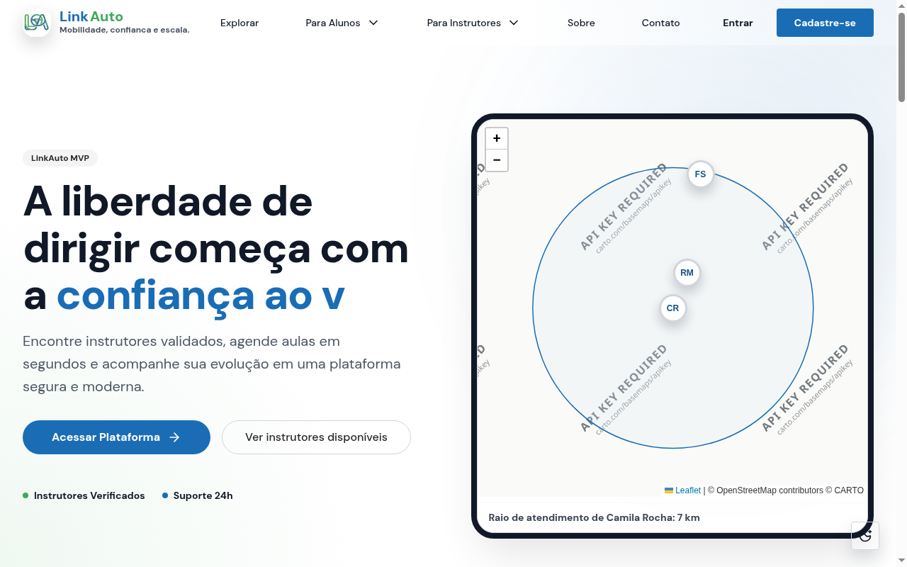
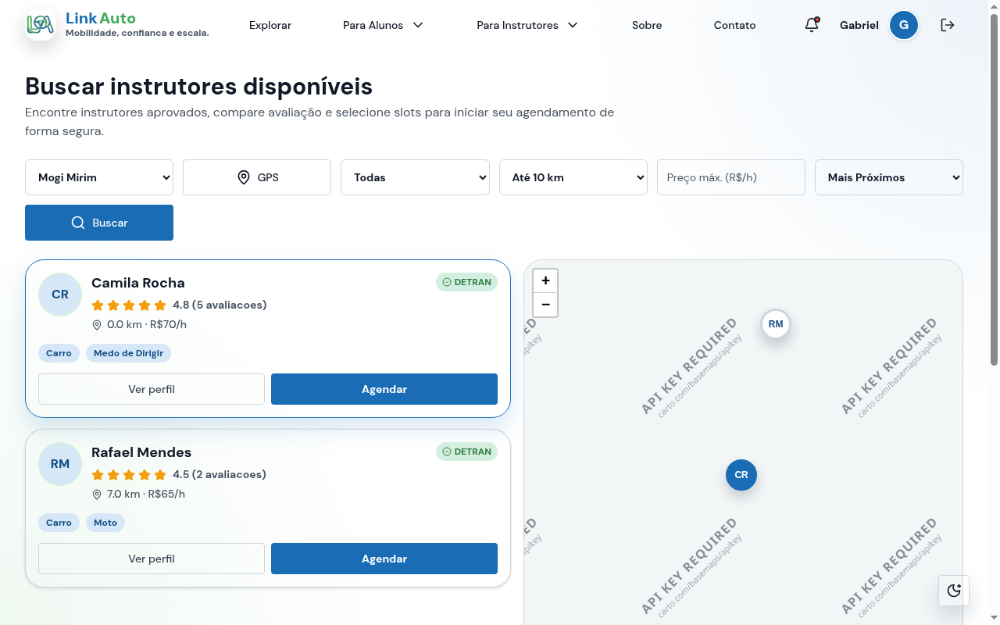
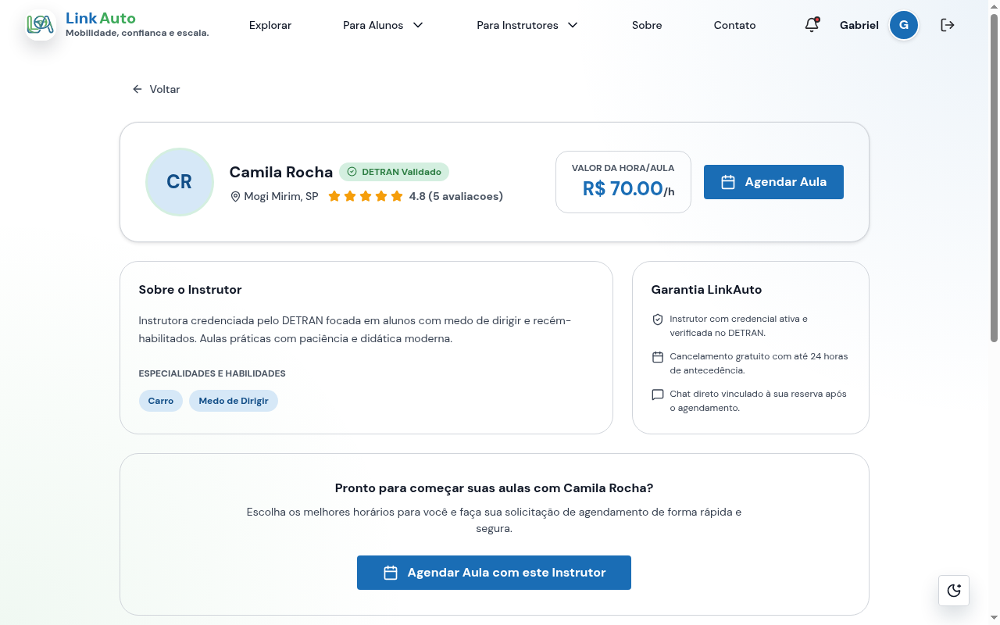
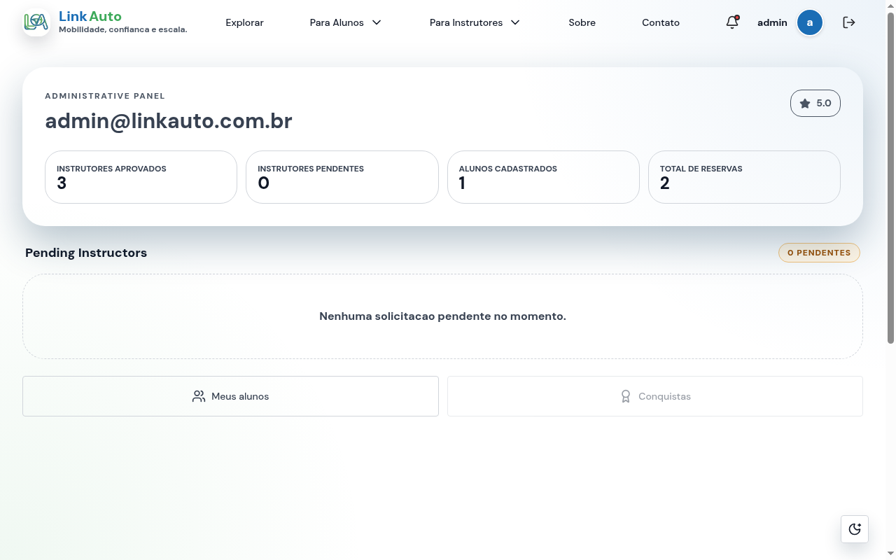

# LinkAuto 🚗💨

Plataforma mobile-first para conectar alunos e instrutores autônomos de trânsito credenciados pelo DETRAN.

Idiomas:
- 🇧🇷 **PT-BR:** [README.md](README.md)
- 🇺🇸 **US-EN:** [docs/README.en.md](docs/README.en.md)

Navegação rápida:
- [Visão Geral](#visão-geral)
- [Demonstração Visual](#demonstração-visual)
- [Status do Projeto](#status-do-projeto)
- [Endpoints Operacionais](#endpoints-operacionais-da-api)
- [Arquitetura e Stack](#arquitetura-e-stack)
- [Como Executar](#como-executar-localmente)
- [Qualidade e Testes](#qualidade-e-testes)
- [Segurança & LGPD](docs/SECURITY_TECHNIQUES.md)


---

## Visão Geral

O **LinkAuto** é uma plataforma inovadora que organiza o fluxo de descoberta geolocalizada de instrutores de direção, credenciamento administrativo pelo DETRAN, perfis públicos com blindagem LGPD, agendamento de aulas com regras de negócio seguras e avaliações mútuas de reputação.

### Escopo Consolidado
- **Usuários Multi-Role:** Perfis de `ALUNO`, `INSTRUTOR` e `ADMIN`.
- **Autenticação Segura:** JWT de curta duração com renovação silenciosa via `refresh_token` em cookies `HttpOnly` seguros.
- **Validação de Credenciamento DETRAN (RN01):** Moderação manual pelo Administrador e envio de documentos com validação por Magic Bytes.
- **Perfis Públicos Anônimos (LGPD / RNF03):** Acesso a perfis por **slugs seguros** (ex: `/instructors/carlos-silva-mogi-mirim-8f2a`), blindando 100% dos UUIDs internos e dados pessoais (PII).
- **Agendamento Inteligente (RN02-RN04):** Slots de 1 hora, agendamento mínimo de 2 horas consecutivas, máquina de estados e penalidade de 7 dias para cancelamentos com menos de 24h.
- **Avaliações Mútuas & Fórum de Mensagens:** Histórico de conversas por agendamento e avaliações de 1 a 5 estrelas com recálculo automático de reputação do instrutor.
- **Dashboards em Tempo Real:** Painéis analíticos com métricas operacionais para administradores e instrutores.

### Documentação Canônica (Single Source of Truth)
- 📜 **Requisitos e Regras de Negócio:** [`docs/requirements.md`](docs/requirements.md)
- 🏛️ **Diagramas de Classe do Banco de Dados:** [`docs/DATABASE_CLASS_DIAGRAMS.md`](docs/DATABASE_CLASS_DIAGRAMS.md)
- 🎨 **Design System e Padrões de Interface:** [`docs/DESIGN.md`](docs/DESIGN.md)
- 🔌 **Especificações de Endpoints da API:** [`docs/BACKEND_ENDPOINT_REQUESTS.md`](docs/BACKEND_ENDPOINT_REQUESTS.md)
- 🚀 **Decisões e Checklist de Rollout:** [`docs/ROLLOUT.md`](docs/ROLLOUT.md)
- 🛡️ **Técnicas de Segurança e Hardening:** [`docs/SECURITY_TECHNIQUES.md`](docs/SECURITY_TECHNIQUES.md) e [`docs/SECURITY_COMPARISON.md`](docs/SECURITY_COMPARISON.md)
- 📖 **Documentação Interativa Swagger:** [http://localhost:8000/docs](http://localhost:8000/docs) (OpenAPI em `/openapi.json`)

---

## Demonstração Visual

Abaixo, algumas das principais interfaces do LinkAuto em operação:

| Landing Page (Hero & Demonstração) | Busca Geolocalizada com Leaflet |
| :---: | :---: |
|  |  |

| Perfil Público do Instrutor (Slug & LGPD) | Painel de Gestão & Estatísticas |
| :---: | :---: |
|  |  |

---

## Status do Projeto

### Progresso por Fase

| Fase | Estado | Cobertura & Destaques |
| :--- | :---: | :--- |
| **Phase 1 - Setup** | Concluída | FastAPI, envelopes comuns, Docker Compose inicial |
| **Phase 2 - Foundational** | Concluída | JWT access/refresh, SQLite dev, máquina de estados base |
| **Phase 3 - US1** | Concluída | Cadastro, login, upload de documentos e aprovação Admin |
| **Phase 4 - US2** | Concluída | Slots de 1h, agendamentos consecutivos (min 2h), penalidades RN04 |
| **Phase 5 - US3** | Concluída | Mensagens por agendamento, reviews mútuas, lembrete 24h e 8 e-mails SES |
| **Phase 6 - Polish & Hardening** | Concluída | Rate limit SlowAPI, security headers, magic bytes, fail-fast e correlation IDs |
| **Phase 7 - Frontend Integration** | Concluída | Conexão 100% com API real, geolocalização com fallback, 97 testes Vitest verdes |
| **Phase 8 - Tooling & Stack Integration** | Concluída | Migração para `uv`, `SQLModel 0.0.48`, typechecker `ty`, Alembic baseline e workspace multi-root |

### Resumo de Validação
- 🟢 **Backend:** suíte Pytest verde, 0 erros no `ty check`, 0 avisos no `ruff check` (regras `ALL`).
- 🟢 **Frontend:** suíte Vitest verde, 0 erros no TypeScript (`npm run typecheck` estrito).

---

## Endpoints Operacionais da API

A referência completa e sempre atual é a documentação interativa em `/docs` (Swagger, gerada pela própria API). Resumo por área:

- **Infraestrutura:**
  - `GET /health` — Verificação de saúde da API
  - `GET /api/v1/foundation/ping` · `whoami` · `protected` · `admin` e `POST /api/v1/foundation/conflict` — Rotas de diagnóstico (latência, IP visto pela API, autenticação, autorização e envelope de conflito)
- **Autenticação:**
  - `POST /api/v1/auth/register` — Cadastro de alunos e instrutores com e-mail válido e nome opcional (papel ADMIN bloqueado)
  - `POST /api/v1/auth/login` — Autenticação com limites por IP e por conta
  - `POST /api/v1/auth/refresh` — Rotação de refresh token de uso único, com detecção de reuso
  - `POST /api/v1/auth/logout` — Revoga a sessão e apaga o cookie
  - `POST /api/v1/auth/password-reset` — Pedido de redefinição de senha (link por e-mail, quando houver provedor)
  - `POST /api/v1/auth/password-reset/confirm` — Define a nova senha com o link de uso único e encerra todas as sessões
- **Usuários & Perfis:**
  - `GET /api/v1/users/me` · `PATCH /api/v1/users/me` — Dados e perfis do usuário logado (campos validados, slug público incluído)
  - `GET /api/v1/users/public-instructors` — Cartões públicos dos instrutores aprovados
  - `GET /api/v1/instructors/{slug}/public` · `GET /api/v1/students/{slug}/public` — Perfis públicos por slug (IDs internos não são aceitos)
- **Busca Geolocalizada:**
  - `GET /api/v1/instructors/search` — Busca por raio (Haversine) com filtros por especialidade, nota e preço
- **Horários (Slots):**
  - `GET /api/v1/instructors/me/slots` · `POST /api/v1/instructors/me/slots` — Agenda do instrutor; slots de exatamente 1h, no futuro, sem sobreposição
  - `DELETE /api/v1/instructors/me/slots/{slot_id}` — Remove um horário livre
  - `GET /api/v1/instructors/{slug}/slots` — Horários futuros de um instrutor aprovado (público)
- **Agendamentos (Bookings):**
  - `POST /api/v1/bookings` — Solicitação atômica (mínimo 2 slots consecutivos de um instrutor aprovado)
  - `GET /api/v1/bookings` — Minhas aulas; `?as=student|instructor` escolhe o lado e `?status=` filtra
  - `GET /api/v1/bookings/{id}` — Detalhe para os participantes e admins
  - `PATCH /api/v1/bookings/{id}/confirm` — Confirmação pelo instrutor
  - `PATCH /api/v1/bookings/{id}/cancel` — Cancelamento com regra de 24h e suspensão automática RN04
- **Mensagens & Avaliações:**
  - `GET /api/v1/bookings/{id}/messages` · `POST /api/v1/bookings/{id}/messages` — Chat do agendamento (até 2000 caracteres, 20 por minuto)
  - `POST /api/v1/bookings/{id}/reviews` — Avaliação mútua liberada apenas para aulas REALIZADAS
  - `GET /api/v1/instructors/{slug}/reviews` — Avaliações públicas recebidas como instrutor
- **Credenciamento & Administração:**
  - `POST /api/v1/instructors/{id}/documents` — Envio da credencial DETRAN e dos antecedentes (até 10 MB cada)
  - `GET /api/v1/admin/instructors?status=` — Fila de credenciamentos, paginada
  - `GET /api/v1/admin/instructors/{id}/documents` — Documentos com links temporários
  - `PATCH /api/v1/admin/instructors/{id}/approve` · `PATCH .../reject` — Aprovação ou rejeição com motivo
  - `PATCH /api/v1/admin/bookings/{id}/override-status` — Forçar REALIZADA ou CANCELADA, com trilha de auditoria
  - `POST /api/v1/admin/users/{id}/password-reset-link` — Link de redefinição entregue pelo admin enquanto não há e-mail (contas de admin recusadas)
  - `GET /api/v1/admin/stats` · `GET /api/v1/instructor/stats` — Métricas globais e do instrutor
- **Automação & Jobs** (agendados com `python -m app.jobs run all` a cada 15 min; ver [`infra/README.md`](infra/README.md#-jobs-agendados-agendamentos)):
  - `POST /api/v1/jobs/booking-timeout` · `booking-completion` · `booking-reminder` — Execução manual dos jobs pelo admin

---

## Arquitetura e Stack

```text
.
├── LinkAuto-APP.code-workspace  # Workspace multi-root com tooling integrado para VS Code
├── docs/                        # Documentação canônica (Requisitos, Design, Endpoints, Segurança)
│   ├── archive/                 # Registros históricos e rascunhos de iterações anteriores
│   └── images/                  # Identidade visual e capturas de tela do showcase
├── infra/                       # Docker Compose (os Dockerfiles multi-stage ficam em cada app)
├── linkauto-backend/            # API FastAPI (SQLModel 0.0.48, uv, ty, Alembic, SQLite/PostgreSQL)
└── linkauto-frontend/           # SPA React 19 (Vite, Chakra UI v3, Tailwind CSS 4, Vitest)
```

- **Frontend:** React 19.2, Vite, Tailwind CSS 4, Chakra UI v3, React Router DOM 7, Leaflet, Vitest.
- **Backend:** Python 3.14 (gerenciado por `uv`), FastAPI, SQLModel 0.0.48, Alembic, Pydantic v2, psycopg 3, Ruff, ty.
- **Banco de Dados:** SQLite com auto-seed no ambiente de desenvolvimento; PostgreSQL + PostGIS em produção.
- **Serviços Cloud:** AWS S3 (armazenamento temporário de credenciais) e AWS SES (notificações por e-mail).

---

## Como Executar Localmente

### Opção A: Docker Compose (Recomendada) 🐳

Para iniciar todo o ecossistema (Backend, Frontend e Banco) em segundo plano:

```bash
docker compose -f infra/docker-compose.yml up -d
```

> [!TIP]
> Para o guia detalhado de comandos Docker, resolução de problemas e testes via container, consulte o **[Guia de Infraestrutura & Docker (infra/README.md)](infra/README.md)**.

Serviços disponíveis:
- 🌐 **Frontend (Web App):** [http://localhost:5173](http://localhost:5173)
- 🔌 **Backend API (Swagger Docs):** [http://localhost:8000/docs](http://localhost:8000/docs)
- 🩺 **Healthcheck da API:** [http://localhost:8000/health](http://localhost:8000/health)

Credenciais de desenvolvimento pré-semeadas:
- **Aluno:** `aluno@linkauto.com.br` / `password123` (Slug: `gabriel-silva-mogi-mirim-1a2b`)
- **Instrutor:** `camila@linkauto.com.br` / `password123` (Slug: `camila-rocha-mogi-mirim-8f2a`)
- **Admin:** `admin@linkauto.com.br` / `password123`

---

### Opção B: Ambiente Nativo

#### 1. Backend (`linkauto-backend`)
Requer [uv](https://docs.astral.sh/uv/) instalado:

```bash
cd linkauto-backend
uv sync                                            # Cria o .venv e instala dependências exatas
uv run uvicorn app.main:app --reload --port 8000   # Inicia a API com hot-reload
```

#### 2. Frontend (`linkauto-frontend`)
Requer Node.js 26+:

```bash
cd linkauto-frontend
npm install
npm run dev
```

#### 3. Desenvolvimento no VS Code
Abra o arquivo [`LinkAuto-APP.code-workspace`](LinkAuto-APP.code-workspace) para que o VS Code utilize automaticamente o interpretador Python do `uv`, o formatador Ruff e o servidor de linguagem `ty` para o backend, juntamente com o tooling do Node.js para o frontend.

---

## Qualidade e Testes

### Backend (`linkauto-backend`)
```bash
cd linkauto-backend
uv run ty check              # Verificação estrita de tipos estáticos
uv run ruff check .          # Linting com todas as regras Ruff habilitadas
uv run ruff format --check . # Verificação de formatação de código
uv run pytest                # Testes unitários, de contrato e integração
```

### Frontend (`linkauto-frontend`)
```bash
cd linkauto-frontend
npm run typecheck            # Compilação estrita TypeScript (exactOptionalPropertyTypes)
npm run lint                 # Análise estática com ESLint
npm run test                 # Testes automatizados com Vitest
```

### Integração Contínua (GitHub Actions)
Cada pull request e cada push em `main` executam os workflows em [`.github/workflows/`](.github/workflows/):

- **Backend** (`backend.yml`): `uv sync --locked`, `pip-audit` das dependências de runtime, Ruff (lint e formatação), ty, pytest, `alembic upgrade head` + `alembic check` em um SQLite novo, e um job que aplica, verifica e reverte as migrações em um container `postgis/postgis:16-3.4-alpine`.
- **Frontend** (`frontend.yml`): `npm ci`, `npm audit --omit=dev --audit-level=high`, ESLint, TypeScript, Vitest com os limites de cobertura e build do Vite.
- **Docker** (`docker.yml`): valida o Compose (perfis padrão e `postgres`), constrói as imagens de produção e testa cada uma rodando: o backend recusa subir sem `JWT_SECRET`, migra e responde `/health`; o frontend exige `VITE_API_BASE_URL` e serve as rotas do SPA. Roda quando mudam `infra/`, Dockerfiles, `.dockerignore`, `nginx.conf` ou manifestos de dependências.
- **Dependabot** (`.github/dependabot.yml`): atualizações semanais de npm, uv, GitHub Actions e imagens Docker.

Os jobs só rodam quando o respectivo app muda (ou sempre, se não for possível comparar com a base, como após um *force-push*), mas os checks agregadores **`Backend OK`**, **`Frontend OK`** e **`Docker OK`** sempre reportam um status. Configure esses três como *required status checks* na proteção da branch `main` (Settings → Branches); em PRs empilhados cada camada roda os checks contra a sua base.

### Testes E2E e Validação Visual
Os testes de interface e jornada do usuário são conduzidos nativamente através do **Chrome DevTools MCP** (`@browser-testing-with-devtools`), permitindo capturas em alta resolução, inspeção de DOM e validação de contratos em tempo de execução.
